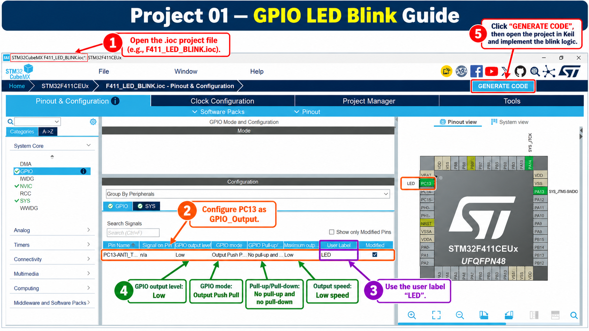
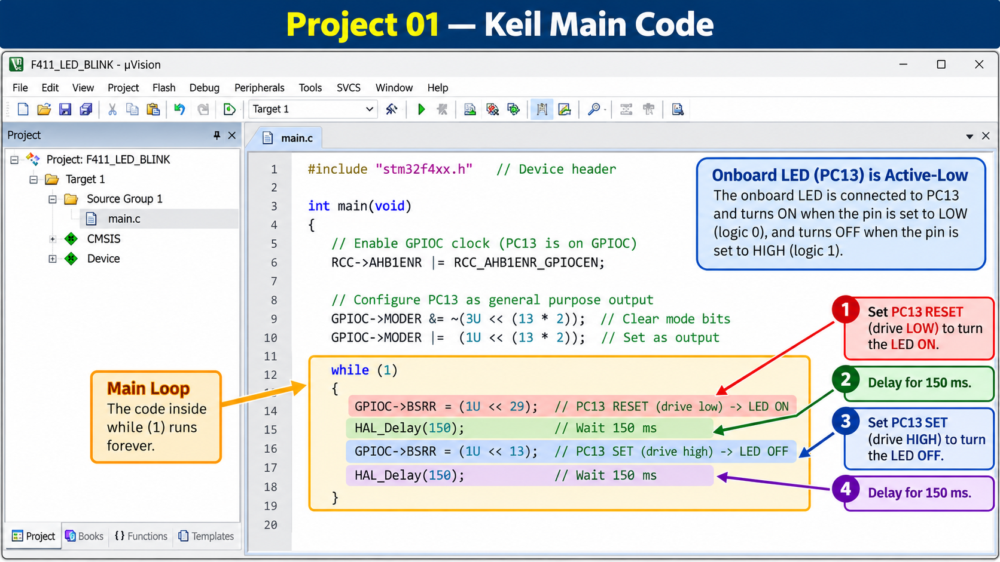

# Project 01 - GPIO LED Blink

## Objective

Blink the onboard LED of the STM32F411CEU6 Black Pill using GPIO output and STM32 HAL.

## Hardware

- STM32F411CEU6 Black Pill
- ST-Link V2
- SWD interface
- Onboard LED connected to PC13

## Pin Mapping

| Function | STM32 Pin | Board Label |
|---|---|---|
| Onboard LED | PC13 | C13 |
| SWDIO | PA13 | A13 |
| SWCLK | PA14 | A14 |

## GPIO Configuration

PC13:

- GPIO Output
- Push-Pull
- No pull-up / pull-down
- Low speed
- User Label: `LED`

The onboard LED is active-low:

- GPIO LOW -> LED ON
- GPIO HIGH -> LED OFF

## Main Logic

```c
HAL_GPIO_WritePin(LED_GPIO_Port, LED_Pin, GPIO_PIN_RESET);
HAL_Delay(150);

HAL_GPIO_WritePin(LED_GPIO_Port, LED_Pin, GPIO_PIN_SET);
HAL_Delay(150);
```

## Step-by-Step Visual Guide







