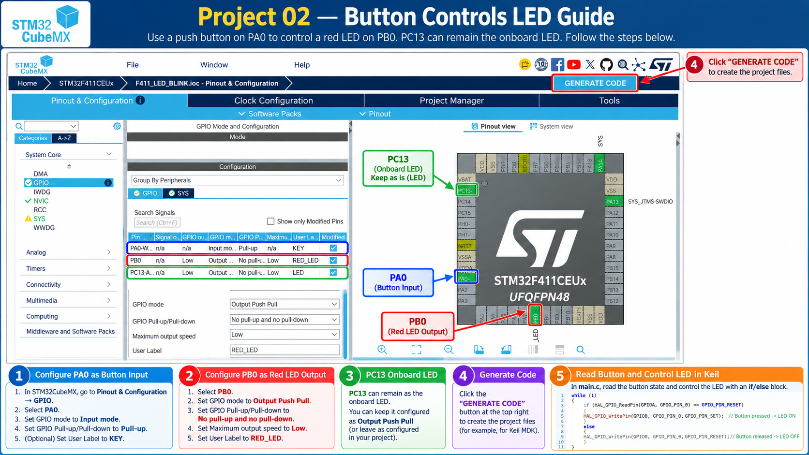
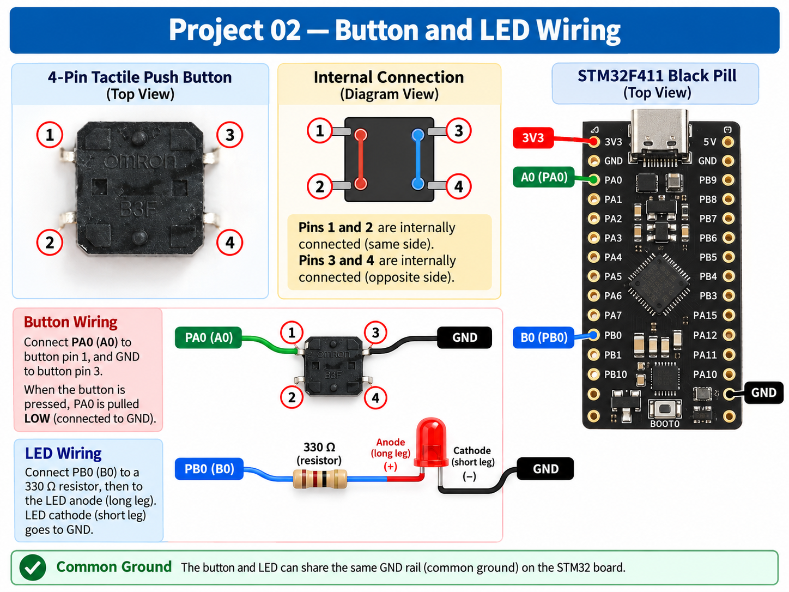
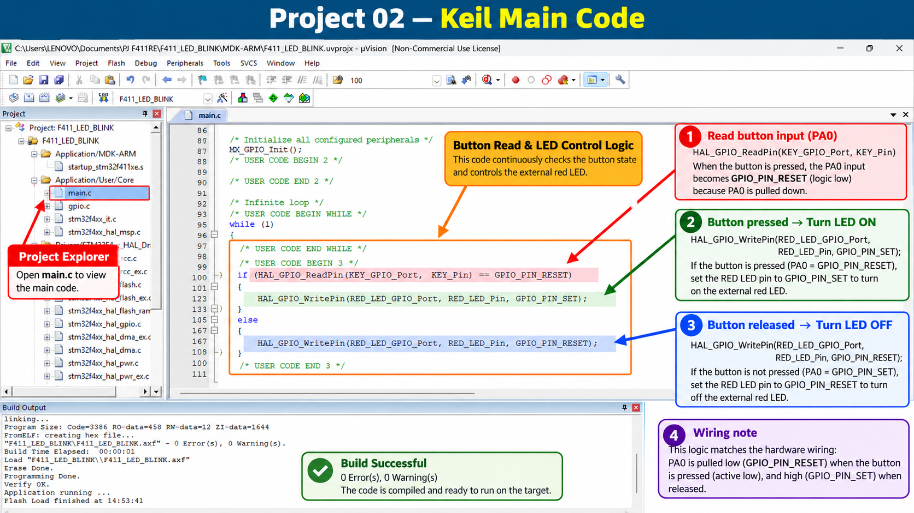

# Project 02 - GPIO Button Controls External LED

## Objective

Read an external push button using PA0 and control an external red LED using PB0.

## Hardware

- STM32F411CEU6 Black Pill
- ST-Link V2
- 4-pin tactile button
- Red LED
- 330 ohm resistor
- Jumper wires

## Pin Mapping

| Function | STM32 Pin | Board Label |
|---|---|---|
| Button | PA0 | A0 |
| Red LED | PB0 | B0 |
| SWDIO | PA13 | A13 |
| SWCLK | PA14 | A14 |
| Ground | GND | G |

## Wiring

Button:

PA0 -> Button pin 1  
GND -> Button pin 3

External LED:

PB0 -> 330 ohm resistor -> LED Anode (+)  
LED Cathode (-) -> GND

## GPIO Configuration

### PA0 - Button

- Mode: GPIO Input
- Pull-up: Enabled
- User Label: KEY

The button is active-low:

- Released = HIGH
- Pressed = LOW

### PB0 - Red LED

- Mode: GPIO Output Push-Pull
- Pull-up/Pull-down: None
- Speed: Low
- User Label: RED_LED

## Main Logic

```c
if (HAL_GPIO_ReadPin(KEY_GPIO_Port, KEY_Pin) == GPIO_PIN_RESET)
{
    HAL_GPIO_WritePin(RED_LED_GPIO_Port, RED_LED_Pin, GPIO_PIN_SET);
}
else
{
    HAL_GPIO_WritePin(RED_LED_GPIO_Port, RED_LED_Pin, GPIO_PIN_RESET);
}
```

## Step-by-Step Visual Guide







